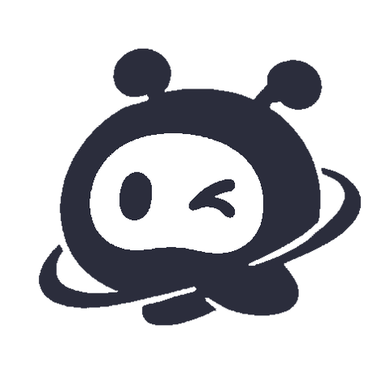

# 官鸡机器人管理后台

<p align="center">
  
</p>

<p align="center">
  <a href="https://github.com/yzdz666/QQbot/releases"></a>
  <a href="https://github.com/yzdz666/QQbot/releases"></a>
</p>

> 基于 PHP + SQLite 的 QQ 官方机器人框架，支持 WebHook 与 WebSocket 双模式，自带可视化后台与**插件市场**。不用装数据库、不用写接入代码，**填完 AppID / AppSecret 就能收消息，往 `plugin/` 丢一个 PHP 文件就是一条指令**。

QQ群：973942141（进群请备注「开源」）
注意：禁止倒卖，仅供学习与二次开发。

## 目录

- [新手上路：从零跑通第一个机器人](#新手上路从零跑通第一个机器人)
- [QQ 开放平台配置详解](#qq-开放平台配置详解)
- [两种接入模式怎么选](#两种接入模式怎么选)
- [功能特性](#功能特性)
- [环境要求](#环境要求)
- [后台功能导览](#后台功能导览)
- [插件开发](#插件开发)
- [常见问题排查](#常见问题排查)
- [部署安全清单](#部署安全清单)
- [目录结构](#目录结构)
- [忘记后台密码](#忘记后台密码)
- [插件市场](#插件市场)
- [技术栈 / 许可证 / 致谢](#技术栈)

---

## 新手上路：从零跑通第一个机器人

这一章给第一次接触 QQ 官方机器人的新手。整条链路只有六个步骤：

```
QQ 开放平台建机器人 → 部署本框架 → 安装向导填凭证 → 启动接收 → 扫码把机器人加进 QQ → 发消息验证
```

> **先弄清楚一件事**：QQ 官方机器人不是私聊一个普通 QQ 号，必须在 [QQ 开放平台](https://q.qq.com) 创建应用、通过开发者认证，机器人才能出现在 QQ 里。框架只负责「收到消息后怎么处理、怎么回复」，账号和权限都在开放平台侧配置。

### Step 1 · 准备三样东西

| 需要 | 说明 |
|------|------|
| 一台 PHP 服务器 | 虚拟主机 / 云服务器 / 宝塔面板 / NAS 都行，PHP ≥ 7.4 |
| 一个已实名认证的 QQ 号 | 用于注册开放平台开发者（需扫码 + 人脸认证） |
| 域名 + HTTPS | **只有 WebHook 模式必需**；用 WebSocket 模式可以完全不要公网地址 |

> 新手建议直接用 **WebSocket 模式**：不需要域名、不需要备案、不需要内网穿透，本地电脑 / 家用 NAS 就能跑。

### Step 2 · 在 QQ 开放平台创建机器人

1. 打开 [QQ 开放平台](https://q.qq.com)，用 QQ 扫码注册开发者账号，完成**超级管理员设置 + 主体认证**（个人主体填姓名/身份证/手机号并人脸验证；企业主体需工商资质与对公打款校验）。
2. 进入 **QQ 机器人 → 创建机器人**，填写名称、头像、简介，提交后即生成 `AppID`。
3. 点进机器人，在 **开发管理**（部分版本叫「开发设置 / 开发基础设置」）里复制 **AppID** 与 **AppSecret**：
   > **AppSecret 不支持明文保存，只在首次查看时可见，忘记只能重新生成。** 先存到备忘录里。
4. 在 **安全设置 → IP 白名单** 加入服务器的公网 IP。非沙箱环境调用官方 OpenAPI 时，只有白名单 IP 能调通。
5. 在 **沙箱配置** 里把机器人加进测试范围（详细见下一章）：
   - **消息列表配置** → 添加成员（填你自己的 QQ 号）→ 用 QQ 扫页面上「使用范围与人员」的二维码 → 点「发消息」授权添加，机器人出现在消息列表。
   - **QQ 群配置** → 下拉选择测试群 → 在 QQ 群「设置 → 群机器人」里把测试机器人添加进群。
6. 选择接入方式（两种只做一种）：
   - **WebSocket 模式**：开放平台**不用配回调地址**，框架主动连网关，事件订阅（intents）由框架内置处理，跳到 Step 3。注意特殊事件的**权限**仍需在开放平台申请，权限与订阅是两回事。
   - **WebHook 模式**：在管理端 **Webhook 设置**（部分版本叫「回调配置」，回调地址与事件监听在同一处或相邻菜单）勾选需要监听的事件——单聊勾 `C2C 消息事件`、群聊勾 `群消息事件 / AT 事件`——并填回调地址 `https://你的域名/index.php`。保存时平台会立刻发一个 `op=13` 验证请求，框架的 `sign()` 会自动用 AppSecret 完成 Ed25519 签名应答，**看到保存成功即验签通过**。

> 沙箱阶段**不需要发布上架**，机器人名字会带「-测试中」后缀，只有沙箱里添加的成员能跟它对话。等要给别人用，再走「机器人配置 → 开发 → 提交审核 → 审核通过 → 手动上线」，上线后普通用户才能在 QQ 里搜索并添加。

### Step 3 · 部署框架并安装

1. 把整个目录上传到 Web 根目录（如 `/www/wwwroot/你的域名/`），确保 `data/`、`market/data/`、`market/storage/` 可写。
2. 浏览器访问 `http://你的域名/install.php`，按向导走完四步：
   1. 环境检测（缺扩展会直接列出来）
   2. 设置管理员账号密码
   3. 添加机器人：填入 Step 2 拿到的 **AppID**、**AppSecret**，**环境**与开放平台保持一致（沙箱调试选「沙箱」）
   4. 完成
3. 装完向导自动锁定（`setup_complete`），再访问会跳转后台登录，不会被用来重置管理员。
4. 建议跑一次自检：`php self_check.php`，或登录后台后访问 `/self_check.php`，一次性检查目录权限、数据库、接口域名、守护进程状态。

> 想省事也可以勾上安装向导里的「启用 WebSocket」，后台会自动记录 WS 配置。**WebSocket 与 WebHook 二选一，不要同时开**，否则同一条事件会被处理两次。

### Step 4 · 启动接收

**WebSocket 模式**（四选一，推荐第 2 种）：

```bash
# 1) 前台临时试跑（关掉终端就断）
php ws_client.php

# 2) systemd 守护进程（Linux 推荐，开机自启 + 断线重连）
cd /www/wwwroot/你的路径
WEB_USER=www ./install_ws_service.sh

# 3) 后台 → 系统设置 → WebSocket 模式 → 点击「启动守护进程」

# 4) 服务器禁用 shell_exec / proc_open 时，改用 cron
* * * * * /bin/bash /你的路径/ws_monitor.sh
```

> **不要直接用 root 跑 `php ws_client.php`**：SQLite 的 db / WAL 文件会变成 root 属主，后台随后报 `unable to open database file`。用 systemd 脚本指定 `WEB_USER=www`（或 `www-data`）与 Web 服务同一用户。

**WebHook 模式**：不用启动任何进程，只要 Step 2 的回调地址验证通过即可。前提是 `sodium` 扩展可用（验签必需）、域名有 HTTPS。

### Step 5 · 让机器人收到你的消息

1. 在 QQ 里给机器人发一条消息（比如 `菜单`）。
2. 如果 QQ 提示「机器人去火星了，稍后再试」，说明**机器人已经加进 QQ，但你的服务还没连上平台**——检查 WS 进程是否活着、或 WebHook 回调是否验证通过。连上后提示会自动消失。
3. 打开后台 **消息日志 / 聊天记录**，能看到这条消息就说明链路通了。
4. 没通也别急，后台 **指令测试** 页可以离线模拟一条事件，先验证插件逻辑是否正确。

### Step 6 · 写第一个插件

在 `plugin/` 下新建 `hello.php`：

```php
<?php
/**
 * @name 我的第一个插件
 * @version 1.0.0
 * @author 你的昵称
 */

if (消息 == "你好") {
    文字("你好呀，我是 " . 用户 . " 的机器人");
    return;
}

if (消息 == "发张图") {
    图片("https://picsum.photos/400/300", "📸 一张示例图");
    return;
}
```

保存后**不用重启、不用刷新**，给机器人发「你好」就会收到回复。插件目录每次事件都会重新扫描。

几个立刻能用的常量和函数：

| 常量 / 函数 | 作用 |
|------|------|
| `消息` | 用户发的内容（已去掉 @ 前缀和 `/` 前缀） |
| `用户` / `来源` | 发送者 openid / 群或私聊 openid |
| `消息来源` | `群聊`、`私聊`、`加群`、`退群`、`互动` 等 |
| `appid` / `消息ID` / `事件ID` | 机器人 ID / 被动回复锚点 / 事件锚点 |
| `raw` | 官方原始事件数组，取 `message_scene`、`attachments` 等用 |
| `文字()` / `图片()` / `MD()` | 发文本 / 图片 / Markdown |
| `引用()` / `撤回()` | 引用回复 / 撤回消息 |

完整变量表、全部消息函数与 API 封装清单见 [`文档.md`](文档.md)，或后台 **开发文档** 页。

---

## QQ 开放平台配置详解

这一章把「开放平台上到底要填什么」逐项列清楚。管理端入口：[我的机器人](https://q.qq.com/qqbot/)，官方文档：[Bot API v2](https://bot.q.qq.com/wiki/develop/api-v2/)。

> 开放平台菜单名称偶有调整，以下按现行名称书写，以页面实际显示为准。

### 配置项对照表

| 开放平台位置 | 要做什么 | 对应框架配置 |
|---|---|---|
| **QQ 机器人 → 创建机器人** | 建应用，拿到 `AppID` | 安装向导第 3 步 / 后台「机器人管理」 |
| **开发管理 → AppID / AppSecret** | 复制凭证，**AppSecret 只显示一次** | 安装向导的 AppID、Secret |
| **安全设置 → IP 白名单** | 填服务器公网 IP | 无（影响主动调用 OpenAPI 能否成功） |
| **回调配置 / 事件订阅** | 勾选 `C2C 消息事件`、`群 AT 事件` 等 | 仅 WebHook 模式；WS 模式的 intents 由框架内置 |
| **Webhook 设置 → 回调地址** | 填 `https://域名/index.php` | `index.php` 入口，`sign()` 自动应答 `op=13` 验证 |
| **沙箱配置 → 消息列表 / QQ 群配置** | 添加测试成员、绑定测试群、扫码添加机器人 | 安装向导「环境」选「沙箱」 |
| **消息 URL 白名单** | 报备机器人消息里会出现的**外链域名** | 发图文卡片、跳转链接前必须配 |
| **使用范围与人员 / 权限申请** | 申请特殊能力、生成添加二维码 | @全体成员、Markdown、主动消息等需单独申请 |

### 三个最容易踩的坑

1. **回调地址 ≠ OAuth 回调地址**。开发设置里的「回调地址」是网页 OAuth 跳转用的（上限 10 条），**WebHook 的回调地址在「Webhook 设置」里配**，两者不是一回事。WebHook 地址必须是 **HTTPS**，端口只允许 `80 / 443 / 8080 / 8443`。
2. **消息里的链接要报备域名**。图文卡片、跳转卡片、Markdown 里的外链，域名必须先加入「消息 URL 白名单」，且域名需已完成 **ICP 备案**（上限 20 条，每年可改 50 次）。没报备的表现是消息发送失败或直接被拦截。
3. **沙箱 ≠ 正式**。沙箱只有配置过的成员/群能对话，机器人带「-测试中」后缀；正式环境必须**提交审核并手动上线**后才对普通用户可用。安装向导里的「环境」要和当前调试的场景一致。

### 多机器人怎么配

多个 AppID 可以**共用同一个 `https://域名/index.php` 回调地址**：平台会在请求头带 `X-Bot-Appid`，框架按它查数据库里对应的 Secret，不需要为每个机器人申请不同域名。在后台「机器人管理」里逐个添加即可。

### 上线之后

| 能力 | 额外条件 |
|---|---|
| 群聊 `@全体成员` | 机器人需为**群管理员**，且每个群每天仅 1 次 |
| 群全量消息 / Markdown / 主动推送 | 需在开放平台**申请对应权限**，未申请的事件不会下发 |
| 主动消息（用户没发消息时推送） | 有频次限制，且用户可在机器人资料卡关闭 |
| 素材图片 `qqbot-media://` | 上传平台换取引用，90 天滑动过期；仅在 QQ 客户端可解析 |

---

## 两种接入模式怎么选

| 对比项 | WebSocket（推荐新手） | WebHook |
|---|---|---|
| 公网域名 / HTTPS | **不需要** | 必须，且端口限 80/443/8080/8443 |
| 开放平台配置 | 无需回调地址 | 回调地址 + 事件订阅 + `op=13` 验证 |
| PHP 依赖 | CLI + `sockets`，需常驻进程 | `sodium` 扩展（Ed25519 验签） |
| 稳定性 | 依赖守护进程存活（systemd/cron 兜底） | 依赖 Web 服务，无进程维护成本 |
| 适合场景 | 本地开发、NAS、无公网 IP、内网环境 | 云服务器、宝塔面板、已有域名 |
| 入口 | `ws_client.php` → `ws_event_handler.php` | `index.php` |

两种模式的事件解析、常量定义、插件加载逻辑完全一致，**插件代码不用改一行**。切换时记得只保留一种，避免重复处理。

---

## 功能特性

- **双模式运行**：WebHook 回调与 WebSocket 主动连接，适配不同服务器环境
- **可视化管理后台**：机器人管理、消息日志、聊天记录、素材管理、群成员管理、指令测试等一站式管理
- **插件系统**：热插拔架构，丢一个 `.php` 到 `plugin/` 即生效，支持 AI 辅助编写
- **插件市场**：自带独立市场站点（前台 + 审核后台），后台可浏览、查看源码、一键安装/更新/卸载
- **官方 API v2**：单聊流式消息、富媒体分片上传、素材管理 `media-images`、群聊 @全体成员、图文卡片 `msg_type=8`、入群申请审批
- **消息档案**：落库时保存昵称、头像、群昵称快照；退群事件区分「群解散」与「被移出」
- **素材管理**：图片上传平台换取 `qqbot-media://` 引用，支持大图分片、预览、复制 Markdown、删除
- **安全防护**：bcrypt 密码、全站 CSRF、同源校验、CSP、登录限流、IP 封禁/白名单、安装向导锁定
- **移动端适配**：响应式设计，适配手机 / 平板 / 桌面
- **零依赖部署**：PHP + SQLite，无需 MySQL，宝塔面板一键部署
- **受限环境兼容**：禁用 `shell_exec`/`proc_open` 的服务器可用定时任务管理守护进程

## 环境要求

| 组件 | 要求 |
|------|------|
| PHP | >= 7.4（推荐 8.0+，已在 8.3 测试）|
| PDO SQLite | 必需 |
| cURL | 必需 |
| mbstring | 必需 |
| GD | 必需（验证码 / 图片处理）|
| openssl | 必需 |
| sodium | **WebHook 模式必需**（Ed25519 回调验签）|
| sockets | 推荐（WebSocket 模式）|
| zip | 市场 zip 投稿 / 下载需要 |

## 后台功能导览

| 页面 | 用途 |
|------|------|
| 首页概览 | 机器人数、在线状态、今日消息量 |
| 机器人管理 | 增删机器人、AppID/Secret/环境、WS 开关 |
| 消息日志 / 聊天记录 | 按会话查看收发消息、昵称头像、系统事件，可手动发消息 |
| 素材管理 | 上传图片换 `qqbot-media://`、复制 Markdown、删除释放配额 |
| 群成员管理 | 成员列表 / 批量移除 / 黑名单 / **入群申请审批** |
| 指令测试 | 离线模拟一条事件，验证插件逻辑 |
| 插件管理 / 插件市场 | 启停插件、浏览安装市场插件 |
| 指令面板 / 菜单 | 配置官方指令面板与菜单 |
| AI 写插件 / 开发文档 | 辅助生成插件、在线查函数手册 |
| 用户管理 / 系统日志 / 数据库 | 用户资料、运行日志、库表维护 |
| 系统设置 / 在线更新 | 接口域名、WS 模式、版本升级 |

## 插件开发

插件放在 `plugin/`，每个 `.php` 文件为一个插件。基本结构：

```php
<?php
/**
 * @name 示例插件
 * @version 1.0.0
 * @author 你的昵称
 */

if (消息 == "测试图片") {
    图片("https://picsum.photos/400/300", "📸 示例图片");
    return;
}
```

- 框架在每次事件时扫描并加载 `plugin/` 下所有 `.php`，**新增/修改即时生效**
- 插件错误会被捕获并记入日志，不会拖垮框架
- 每个事件在独立上下文处理（WH 独立请求 / WS 独立子进程），常量互不干扰
- 可在后台「插件管理」逐机器人启停，或操作 `plugin_status` 表

完整开发文档见 [`文档.md`](文档.md)，或后台 **开发文档** 页。

## 常见问题排查

| 现象 | 优先检查 |
|---|---|
| QQ 提示「机器人去火星了」 | 服务没连上平台：WS 进程是否存活 / WebHook 回调是否验证通过 |
| 开放平台保存回调地址失败 | 域名是否 HTTPS、端口是否 80/443/8080/8443、`sodium` 是否装好、Secret 是否填对 |
| 后台能打开但收不到消息 | 事件订阅是否勾选、AppID 是否在框架里登记、WS 与 WebHook 是否误开成双份 |
| 消息发出去但 QQ 里看不到 | 查系统日志的 API 返回码；主动消息频次限制、链接域名未报备、权限未申请 |
| 后台报 `unable to open database file` | 用 root 跑过 WS 导致 db/WAL 属主变了，改回 Web 用户并 `chown` |
| 发图文卡片 / 跳转链接失败 | 域名未加入开放平台「消息 URL 白名单」，且需已 ICP 备案 |
| 调用 API 报 IP 相关错误 | 服务器公网 IP 未加入开放平台 IP 白名单 |
| 装完想换个环境重来 | 不要删 `data/bot.db` 后访问 install.php（向导已锁定），用后台「机器人管理」改 |

先跑 `php self_check.php` 或后台 `/self_check.php`，能一次排掉大半环境问题。

## 部署安全清单

- [ ] 浏览器访问 `/data/bot.db`、`/market/data/market.db` 应返回 403（Nginx 需手动配置，见 `文档.md` 19.7）
- [ ] 修改市场后台默认密码（默认 `admin` / `JgMk-2026-Q7vL9pXe`）
- [ ] 全站启用 HTTPS（WebHook 验签与市场远程拉取依赖 TLS）
- [ ] 确认 `install.php` 已锁定（访问 `install.php?step=2` 应跳转登录）
- [ ] AppSecret 不外传、不写进前端；Git 仓库里不要提交 `data/*.db`
- [ ] 定期备份 `data/` 与 `market/data/`

## 目录结构

```
官鸡/
├── admin/                # 管理后台
│   ├── api/             # API 接口（含 market.php 市场对接）
│   ├── assets/          # 静态资源
│   ├── market.php       # 插件市场（浏览/安装/更新/源码）
│   ├── material.php     # 素材管理
│   ├── *.php            # 后台页面
│   └── style.css        # 后台样式
├── market/               # 插件市场站点（可独立部署）
│   ├── admin/           # 市场审核后台
│   ├── lib/             # 数据库、鉴权、渲染、审核逻辑
│   ├── data/            # 市场数据库（禁止 Web 访问）
│   ├── storage/         # 投稿包与已发布源码（禁止 Web 访问）
│   ├── seed/            # 示例插件
│   ├── api.php / download.php / submit.php
│   └── config.php       # 市场配置（管理员哈希、站点地址）
├── data/                # 数据目录（SQLite、日志、插件备份）
├── function/            # 核心函数库（Mail / Parsedown / GD / qrcode）
├── plugin/              # 插件目录 ★ 你的业务代码放这里
├── tools/               # 运维工具（reset_admin.php）
├── auth.php             # 认证系统（bcrypt / CSRF / 同源）
├── bot.php              # 机器人核心（含官方 v2 新接口）
├── db.php               # 数据库抽象层与自动迁移
├── function.php         # 全局函数
├── install.php          # 安装向导
├── self_check.php       # 部署自检脚本
├── index.php            # WebHook 回调入口 ★
├── ws_client.php        # WebSocket 客户端
├── ws_event_handler.php # WebSocket 事件处理
├── ws_monitor.sh        # WS 守护进程监控
├── install_ws_service.sh# systemd 服务安装
├── relay.php            # 统一代发网关（WH/WS 通用）
├── 文档.md              # 开发文档（第 19 章为插件市场）
└── README.md
```

## 忘记后台密码

```bash
php tools/reset_admin.php --user=admin --pass=NewPass123
```

仅命令行可执行（Web 访问 403），执行后所有会话失效。市场后台密码通过替换 `market/config.php` 中的 `MARKET_ADMIN_HASH` 重置。

## 插件市场

| 入口 | 地址 | 账号 |
|------|------|------|
| 市场前台 | `/market/` | 无需登录 |
| 市场审核后台 | `/market/admin/` | `admin` / `JgMk-2026-Q7vL9pXe` |
| 机器人后台 | `/admin/market.php` | 安装向导中设置的管理员 |

- **首次登录市场后台后立即修改密码**，并同步更新 `market/config.php` 的 `MARKET_ADMIN_HASH`
- 市场首次访问自动建表并写入 4 个示例插件
- 后台「市场源」默认连接官方在线市场，也可改为自建市场完整地址
- 详细说明见 `文档.md` 第 19 章（含 Nginx 防护配置、API、审核流程）

## 技术栈

- **后端**：PHP 7.4+ / SQLite（PDO）
- **前端**：原生 HTML/CSS/JS，无框架依赖
- **协议**：QQ 开放平台 Bot API v2（WebHook + WebSocket + 流式消息 + 分片上传）
- **安全**：bcrypt 哈希、CSRF Token、同源校验、CSP、登录限流、IP 防护

## 许可证

本项目仅供学习和个人使用。

## 致谢

- [Parsedown](https://github.com/erusev/parsedown) - Markdown 解析器
- [PHPMailer](https://github.com/PHPMailer/PHPMailer) - 邮件发送
- [highlight.js](https://highlightjs.org/) - 代码高亮
